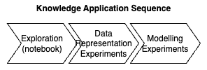
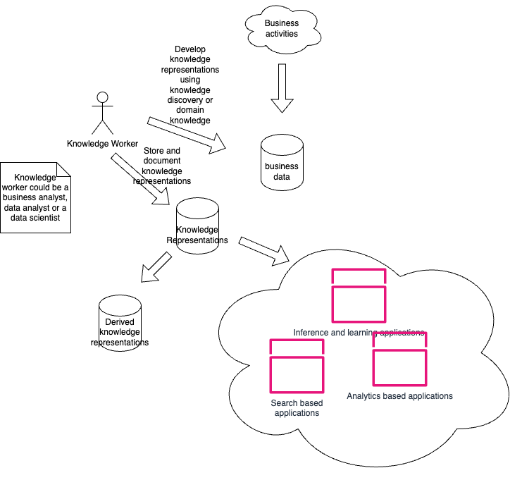
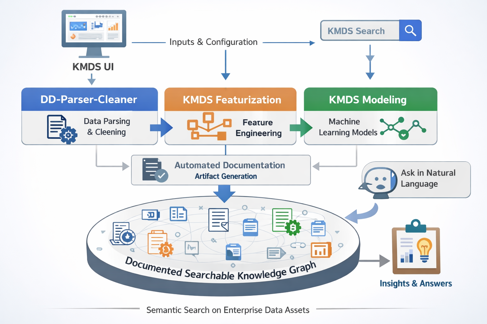

<h1 align="center">KMDS — Knowledge Management for Data Science</h1>

<p align="center">
  <a href="https://kmds.readthedocs.io/en/latest/">
    
  </a>
</p>

<p align="center">
  <strong>Capture the reasoning behind data science work, make it searchable, and warm-start the next modeling iteration with the context that matters.</strong>
</p>

<p align="center">
  <strong>A knowledge layer for data scientists to capture, connect, and retrieve the reasoning behind their analytical work.</strong>
</p>

KMDS is open-source software, freely available for use, customization, and enterprise deployment. It is not a subscription product and does not require licensing fees. It is built to preserve analytical rationale, decision provenance, and model-building context in rigorous data-science workflows.

To see how KMDS achieves reproducibility and structure across analytical projects, see this article: [KMDS-powered ML solutions: insights article](https://github.com/rajivsam/kmds_migration/blob/main/docs/kmds_insights_article.md).

## The intent of this project

KMDS exists to solve a concrete and common problem in data science teams: the work is highly iterative, but the reasoning behind it is not preserved.

Across a project lifecycle, teams accumulate decisions about data quality, feature engineering, modeling choices, evaluation criteria, and business assumptions. These decisions often live in notebooks, Slack threads, scattered documentation, and individual memory. Over time, that context erodes. The next iteration starts not from a clear baseline, but from reconstructed memory.

The result is familiar: duplicated work, inconsistent modeling choices, weak reproducibility, and a loss of continuity between versions of a project.

KMDS is not a general-purpose chatbot or a foundation-model workflow wrapper. It is a structured knowledge-management system for analytical work. It is designed to preserve the context behind decisions, not simply the final outputs.

The central idea is simple:

> Turn the work of data science into a searchable, structured, auditable body of knowledge that can be revisited, reused, and carried forward into the next modeling cycle — a true warm start.

### A different view of intelligent systems

Here is an article that contrasts two distinct ways of thinking about intelligent data solutions: [Beyond the Agent Illusion: Leveraging the Statistical Learning View of Intelligence](https://r2dssanity.substack.com/p/beyond-the-agent-illusion-leveraging?r=3ncgel).

The core point is that the AI-agent view and the statistical-learning/data-science view are not the same thing. One starts from an autonomous system acting in an environment; the other starts from a problem formulation, a learning task, a statistical model, and the structure of the data itself.

KMDS is designed for the statistical-learning/data-science view. It is a tool for teams working to define the right task, capture reasoning, preserve model lineage, and continue the analytical process from one iteration to the next without losing the model-building context that made the prior decision path intelligible.

---

## What KMDS is

KMDS is a project and library for building a durable knowledge layer around analytical workflows.

It helps teams:

- record observations and decisions during data exploration, feature engineering, and modeling
- store them in a structured ontology-backed format
- connect those observations to project artifacts, datasets, reports, and model choices
- search past work semantically through natural-language queries instead of relying on ad hoc file browsing
- review and edit observations in a UI so project history remains visible, correctable, and understandable over time
- ground future decisions in prior evidence and rationale
- preserve the modeling context needed to warm-start the next iteration with continuity and consistency

This is how knowledge sharing happens in practice: technical and non-technical stakeholders can review project history, understand the context behind current decisions, and inspect the evolution of the problem formulation without reconstructing it from scattered notes or individual memory.

## Key references that shaped KMDS

The conceptual foundation of this package was shaped by a small set of influential references in machine learning and data preparation. These works helped define the project’s emphasis on preserving modeling context, reasoning provenance, and structured data understanding rather than treating data science as a sequence of disconnected model runs.

- Hastie, T., Tibshirani, R., & Friedman, J. (2009). The Elements of Statistical Learning: Data Mining, Inference, and Prediction (2nd ed.). Springer. <https://web.stanford.edu/~hastie/ElemStatLearn/>
  - This is the canonical reference for the statistical learning perspective that shapes KMDS. It provides the clearest framing of the core statistical-learning tasks and methods that underpin applied data science: supervised learning, unsupervised learning, model assessment, regularization, and the trade-offs between prediction, inference, and representation. For readers interested in digging deeper into this perspective, this is the best place to begin.
- Domingos, P. (2012). "A Few Useful Things to Know About Machine Learning." Communications of the ACM, 55(10), 78–87. <https://cacm.acm.org/research/a-few-useful-things-to-know-about-machine-learning/>
  - This paper influenced the project’s view that machine learning is not just about final predictive performance, but also about understanding the task, assumptions, feature representation, and decision process. It helped motivate KMDS as a way to preserve the reasoning behind analytical work rather than only the final artifacts.
- Pyle, D. (1999). Data Preparation for Data Mining. Morgan Kaufmann. <https://books.google.co.in/books?hl=en&lr=&id=hhdVr9F-JfAC&oi=fnd&pg=PA1&dq=dorian+pyle+data+preparation+for+data+mining&ots=6iiS6OKzcw&sig=FWBjll_MKa9rbA3AJDHsqhaP2cg&redir_esc=y#v=onepage&q=dorian%20pyle%20data%20preparation%20for%20data%20mining&f=false>
  - This book shaped KMDS’s focus on data quality, feature preparation, and the importance of documenting the transformations and assumptions that underpin analysis. It informed the design of KMDS as a knowledge layer that captures data understanding and decision lineage across the lifecycle of a project.

For readers interested in the statistical learning perspective, the canonical starting point is Hastie, Tibshirani, and Friedman’s The Elements of Statistical Learning. It frames the core tasks and methods of the field in a way that remains authoritative and practically relevant. The other references complement this by reinforcing the importance of decision process, practical modeling judgment, and disciplined data preparation. Together they reflect the same underlying concern that KMDS addresses: preserving the reasoning behind the task, the data, and the model-building process itself.

In practice, KMDS is a framework for making data science work more reproducible, explainable, and transferable.

It sits alongside, not instead of, the normal stack of engineering and machine-learning tooling. It is a tool for the modeler, the analyst, and the data scientist who needs to preserve the intellectual history of a project.

The broader KMDS ecosystem is not a loose collection of unrelated tools. It is a family of task-specific advisors that support the common stages of a statistical learning workflow: data cleaning, feature engineering, model selection, and the decision logic that shapes the representation of the problem itself. In that family are tools such as `dd-parser-cleaner`, `kmds-featurization`, and `kmds-modeling`, each designed to encode the guidance, heuristics, and decision criteria used at that stage of the project.

A particularly important future extension is a heterogeneity detector that helps modelers decide whether a tabular or graph representation is a better fit for the problem at hand. That is precisely the kind of decision-support function that belongs in this ecosystem: not merely logging outcomes, but helping the team reason about the right modeling task before the model is trained.

---

## What KMDS is not

KMDS is not meant to be:

- an experiment management tool
- a workflow management tool
- a generic AI assistant for arbitrary business tasks
- a standalone model registry or MLOps platform
- a replacement for good documentation discipline
- a system that assumes all knowledge is already perfectly structured

It is a practical tool for teams that already produce design docs, notes, notebooks, and reports, and want to make that knowledge usable instead of lost.

### Why this distinction matters

Experiment and workflow tools are designed to manage execution: runs, tasks, schedules, metrics, and operational coordination. They answer questions like: who ran what, when did it execute, and what was the output?

KMDS is different. It is designed for a deeper and more persistent need in modeling teams: preserving the context of the model-building process itself.

The central problem is not lack of execution tracking. It is the loss of modeling continuity. When a project evolves over time, the team often loses:

- the rationale behind a feature choice
- the assumptions that shaped the model design
- the data representation decisions that led to the final formulation
- the reasons a prior approach was rejected or retained
- the context needed to warm-start the next iteration without reinventing the previous reasoning

This is the core idea behind KMDS: the next modeling cycle should not begin from blank-slate memory. It should begin from a documented baseline of modeling context, with the prior design decisions still visible and reusable.

That makes KMDS especially relevant for teams that care about reproducibility, consistency, and continuity in the development of data science projects. It solves a gap that experiment trackers and workflow tools do not address: preserving the intellectual state of the model-building process itself.

---

## The problem KMDS addresses

Small data science teams often face two interconnected failures:

### 1. Knowledge loss

The real value of a data science project is not only the final model or report. It is the reasoning behind:

- why a field was transformed this way
- why a feature was excluded or engineered differently
- why one approach was tried and rejected
- what assumptions were made and how they were validated
- what business or data constraints shaped the solution

That reasoning lives in private notes, Slack threads, notebooks, and memory. KMDS preserves it in a structure that can be searched and reasoned over later, with natural-language search and a UI for viewing and editing observations so the project history remains interpretable to both technical and non-technical stakeholders.

### 2. Decision inconsistency

Without a common knowledge layer, teams make the same trade-offs differently across projects. The same patterns reappear with different labels, inconsistent logic, and no shared record of why an approach was chosen.

KMDS helps stabilize that by giving teams a repeatable way to capture decisions and retrieve them when needed.

### 3. Modeling continuity, re-baselining, and warm starts across iterations

A major but often underappreciated part of operational data science is that the work is never truly static. The data changes, the business process changes, and the assumptions that were valid last quarter may no longer hold this quarter.

That reality is important, but the boundary of the problem must be respected. KMDS is not a monitoring or drift-detection platform. Tools like Evidently and other MLOps monitoring solutions exist to detect and alert on data drift, concept drift, and production model degradation. That is a different layer of the system.

KMDS sits on the modeling side of the lifecycle. It preserves the analyst's reasoning and the project’s analytical continuity across iterations. Its job is to carry forward the intellectual context of a model development cycle:

- the accepted data representations
- the transformations and feature choices that worked
- the rationale behind model selection and tuning decisions
- the known failure modes, assumptions, and edge cases
- the validation criteria and the observed evidence behind them

This makes warm starts possible in a principled way: the next modeling iteration does not begin from blank-slate memory. It begins from a documented modeling baseline, with the earlier reasoning still visible and reusable.

The key point is this: KMDS helps data scientists preserve the modeler's context and decision lineage. It does not replace the monitoring layer used to detect drift in production or during runtime operations.

### Data science utility tool chain

KMDS is best understood as the knowledge layer in a broader data science utility toolchain. It provides tools for the tasks used in typical statistical learning workflows, and the companion packages in this ecosystem support the common stages of that work and encode the guidance used during it. This toolchain is intentionally expert-driven: a human domain expert remains in the loop to validate assumptions, review extracted metadata, and steer the workflow as the system converts raw data into structured knowledge.

- [`kmds-dataset-util`](https://github.com/rajivsam/kmds-dataset-util) supports evaluation of raw data assets, generation of a data dictionary, and conversion into KMDS-consumable data assets with type metadata
- [`dd-parser-cleaner`](https://github.com/rajivsam/dd-parser-cleaner) supports data cleaning and the documentation of data-quality decisions
  - Special mention: its `dataset-bootstrap` CLI bootstraps dataset metadata from a questionnaire, creating the structured metadata foundation for a learning task before the config is generated
- [`featurization`](https://github.com/rajivsam/featurization) supports feature engineering choices and representation strategies
- [`kmds-modeling`](https://github.com/rajivsam/kmds-modeling) supports model selection, evaluation logic, and comparative reasoning across candidate approaches
- [`kmds-data-helper`](https://github.com/rajivsam/kmds-data-helper) scans the components of a KMDS project workspace, makes that structure searchable, and builds a KMDS knowledge graph from the basic repository layout. This is a foundational step in the system: it turns a collection of project artifacts into a navigable, queryable graph rather than leaving the workspace as disconnected files and directories.
- [`kmds-ui`](https://github.com/rajivsam/kmds-ui) provides a user interface for viewing, editing, and searching knowledge graphs. It sits on top of the graph created by the data-helper component, allowing people to inspect the repository-derived knowledge model, refine it, and navigate the resulting graph through a direct UI rather than a terminal-only workflow.

These utilities are not just add-ons. They are the practical advisors that operationalize the data science workflow itself: the guidance that tells a modeler how to decide what is a good representation, what is a defensible transformation, and what modeling family is justified for the task at hand. The system does not replace expert judgment; it captures, structures, and makes it reusable.

KMDS connects these tasks into a coherent knowledge layer. It captures the rationale, preserves the lineage, and makes the knowledge searchable so that future iterations can inherit the design logic rather than rediscover it.

A future extension in this direction is a heterogeneity detector that helps modelers decide whether a tabular or graph representation is a better fit for a given use case. This is the character of the broader toolchain: not merely recording metrics, but guiding modelers toward the right statistical form for the problem.

---

## The operating model

KMDS is designed around a workflow that reflects how real analytical work happens.

### A realistic data science workflow



The workflow typically includes:

1. exploration of raw business or operational data
2. assessment of data quality and relevance
3. transformation into problem-specific data representations
4. experimentation with modeling approaches
5. documentation of rationale and evidence
6. reuse of stored observations in later work

This is the foundation of the project: the analytical journey matters, not just the final artifact.

---

## Why a knowledge graph matters

The project is grounded in the idea that data science knowledge should be represented as relationships between ideas, artifacts, decisions, and evidence.

A knowledge graph makes it easier to connect:

- business objectives
- datasets and data quality issues
- feature engineering choices
- modeling experiments
- assumptions and constraints
- final recommendations and their rationale

This lets teams ask questions like:

- what did we learn about this customer segment last quarter?
- which assumptions have we used repeatedly in similar churn models?
- what representation was evaluated before this final approach?
- where did a decision or model behavior originate?



---

## System architecture

KMDS brings together structured knowledge capture, semantic indexing, and optional search orchestration.



At a high level, the platform combines:

- project artifacts such as documents, reports, and notebooks
- structured observation capture and ontology-driven metadata
- semantic search over the accumulated knowledge base
- optional natural-language routing to project-specific search templates
- generated summaries and insight-oriented retrieval

The project intentionally separates core KMDS functionality from optional integrations such as cloud storage connectors, exploratory pipeline examples, and LLM/reporting features.

---

## Core capabilities

The project provides a core library and CLI surface that supports:

- ontology-backed knowledge representation
- observation ingestion and structured logging
- natural-language search over project knowledge bases
- review and editing of observations through a UI
- semantic indexing using embeddings
- optional query routing to structured retrieval templates
- reproducible command-line workflows for project summaries and search

These capabilities are the practical mechanism for knowledge sharing: stakeholders can inspect the narrative of a project, review the evidence behind decisions, and understand what is happening without needing to reconstruct the context from notebooks, documents, or scattered conversations.

### CLI entry points

Defined in the project metadata:

- `kmds-summary-log`
- `kmds-exec-summary`
- `kmds-search`
- `kmds-ask`
- `kmds-observe`

These entry points support both notebook-driven and CLI-driven usage patterns.

---

## A more accurate description for the project

A concise version of the project message could be:

> KMDS is a knowledge-management and retrieval system for data science teams. It captures analytical decisions, assumptions, and observations in a structured ontology-backed workflow, preserves the reasoning behind model choices across iterations, and helps teams continue from a documented baseline instead of reconstructing context from scratch.

This framing is closer to the actual intent of the project than a generic “LLM workspace” or “AI assistant” pitch.

---

## Why this matters

The value of KMDS is not just productivity. It is operational discipline.

It helps teams:

- reduce dependence on individual memory
- improve auditability of analytical decisions
- preserve domain context across projects and teams
- make project knowledge reusable instead of disposable
- create a searchable record of what was learned, tried, and decided

That is what makes the project useful in professional analytic settings, especially in operational data science and business-facing model development.

---

## Getting started

Install the package locally:

```bash
pip install dd-parser-cleaner kmds-data-helper kmds-ui kmds-featurization kmds-modeling
pip install -e .
```

Or use the repository as a source tree for local workflows and examples.

For more detailed project context, see:

- [README.md](README.md)
- [docs/source/index.rst](docs/source/index.rst)
- [design_considerations/design_rationale.md](design_considerations/design_rationale.md)
- [design_considerations/km_app_pipeline.md](design_considerations/km_app_pipeline.md)
- [design_considerations/knowledge_management_in_DS.md](design_considerations/knowledge_management_in_DS.md)
- [KMDS migration illustrations](https://github.com/rajivsam/kmds_migration) for three separate visualizations of KMDS, including the SBA loan performance use case
- [kmds-dataset-util](https://github.com/rajivsam/kmds-dataset-util) as a utility for evaluating raw datasets and converting them into KMDS-consumable data assets

---

## A final note

The strongest version of KMDS is not “AI for everything.” It is “knowledge infrastructure for analytical work.”

That is the core idea this repository is trying to support: a disciplined way to record, retrieve, and reuse the reasoning that makes data science work trustworthy and reusable.
